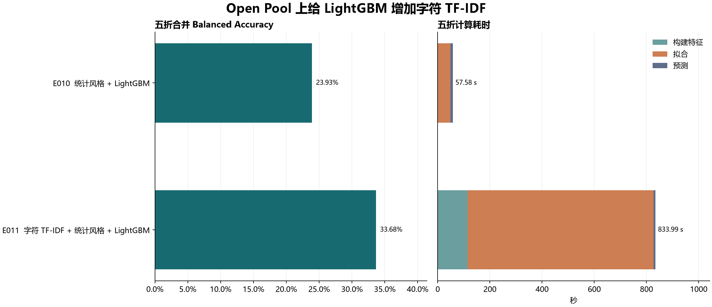

# Open Pool 上给 LightGBM 增加字符 TF-IDF

E010 与 E011 都在同一份 97,050 篇、18 类的 Open Pool 按题五折上评价。原 20 个统计特征值和 LightGBM 训练参数一致。

E011 在训练折按 3–5 字符片段构建 TF-IDF，词表最多 80,000 列，再用训练标签的卡方统计量保留 2,048 个片段。实际输入 2,068 列。逐篇计数共用，列选择、IDF 和卡方得分均从训练侧产生。

| 对照 | 输入 | 合并 BA | Macro-F1 | 五折计算耗时 |
|---|---|---:|---:|---:|
| [E010](../../../runs/E010-open-pool-style-lightgbm/review.md) | 20 项统计 | 23.93% | 23.05% | 57.58 秒 |
| [E011](../../../runs/E011-open-pool-char-style-lightgbm/review.md) | 统计 + 字符 TF-IDF | 33.68% | 33.39% | 833.99 秒 |

**E011 与 E010 的 BA 相差 +9.75 个百分点。** 16,017 篇由错变对，7,156 篇由对变错。按题组重抽 2,000 次的差值区间为 [+9.46, +10.07] 个百分点。

| 折 | E010 BA | E011 BA | 差值，百分点 |
|---:|---:|---:|---:|
| 1 | 24.49% | 34.50% | +10.01 |
| 2 | 24.54% | 33.79% | +9.26 |
| 3 | 23.91% | 33.43% | +9.52 |
| 4 | 23.82% | 33.68% | +9.86 |
| 5 | 23.48% | 33.42% | +9.94 |

E011 另有一次统计特征提取 14.85 秒和一次逐篇字符计数 162.40 秒。E010 的统计特征提取耗时 14.82 秒。

预先只在第一折训练侧测了轻量运行。80,020 列和 4,116 列分别跑了 4 轮，实测耗时 182.06 秒与 9.36 秒。完整五折采用 2,048 个字符特征的方案。

在相同外部池分折和发布方标签下，这组对照衡量加入字符特征的效果。

[逐篇配对](../../../runs/E011-open-pool-char-style-lightgbm/paired_changes.csv) · [E011 混淆矩阵](../../../runs/E011-open-pool-char-style-lightgbm/figures/confusion.png) · [各类召回差值](recall_comparison.csv) · [分折明细](fold_ba.csv)
