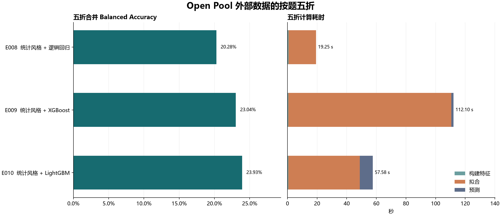

# Open Pool 按题五折

使用 Open Pool 中 **97,050 篇、18 类、17 个来源**。按两个题组编号合并为 12,794 组。每折有 18,715–21,784 篇验证文章，均覆盖 18 类。

原始文件有 231,036 篇。先要求两个题组编号齐备，余 225,110 篇。排除带风险标记的记录后余 138,483 篇，再保留 own_bank 和 own_text。原始和归并题号跨折数均为 0。

标签来自 Open Pool 的 model 字段，其中 64,407 篇缺少实际服务名记录。分数衡量这个外部池里对未见题组的归因表现。

| 实验 | 方法 | BA | Macro-F1 | 各折 BA 范围 | 五折耗时 |
|---|---|---:|---:|---:|---:|
| [E008](../../../runs/E008-open-pool-style-lr/review.md) | 统计风格 + 逻辑回归 | 20.28% | 18.89% | 20.12%–21.26% | 19.25 秒 |
| [E009](../../../runs/E009-open-pool-style-xgboost/review.md) | 统计风格 + XGBoost | 23.04% | 21.97% | 22.59%–23.76% | 112.10 秒 |
| [E010](../../../runs/E010-open-pool-style-lightgbm/review.md) | 统计风格 + LightGBM | 23.93% | 23.05% | 23.48%–24.54% | 57.58 秒 |

三组共享一次逐篇特征提取，耗时 14.82 秒。表中耗时包括各折特征处理、拟合和预测。

## 对照逻辑回归

同一篇文章配对，按合并题组重抽 2,000 次，观察 BA 差值在这批题组上的波动。

| 实验 | BA 差值 | 改对 | 改错 | 配对差值区间 |
|---|---:|---:|---:|---:|
| E009 | +2.76 个百分点 | 9,951 | 6,910 | [+2.50, +3.01] |
| E010 | +3.64 个百分点 | 10,251 | 6,652 | [+3.38, +3.89] |

本轮最高为 **统计风格 + LightGBM（E010），BA 23.93%**。 [混淆矩阵](../../../runs/E010-open-pool-style-lightgbm/figures/confusion.png)

三组共用外部语料、题组分折和 20 项风格特征。正式比赛的隐藏测试由 Kaggle 单独评分，外部语料对官方数据的迁移需要在官方数据上另测。

[分折和语料范围](../../../data/protocols/open-pool-prompt-group-5fold-v1/manifest.json) · [总表](summary.csv) · [各类召回](recall_by_model.csv) · [本轮配置](../../../configs/open_pool_style.toml)
