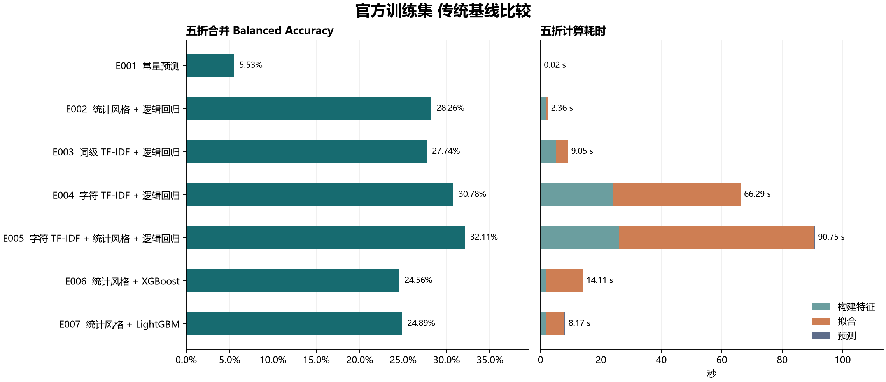

# 第一阶段传统基线实测

七组实验均使用官方训练文本和冻结的按 Prompt 五折。BA、Macro-F1 由完整折外预测复算。耗时为五折的特征构建、拟合和预测之和。

| 实验 | 方法 | 整体 BA | Macro-F1 | 各折 BA 范围 | 计算耗时 |
|---|---|---:|---:|---:|---:|
| [E001](../../../runs/E001-most-frequent-r3/review.md) | 常量预测 | 5.53% | 1.05% | 5.56%–5.56% | 0.02 秒 |
| [E002](../../../runs/E002-style-lr/review.md) | 统计风格 + 逻辑回归 | 28.26% | 26.72% | 26.85%–30.00% | 2.36 秒 |
| [E003](../../../runs/E003-word-tfidf-lr/review.md) | 词级 TF-IDF + 逻辑回归 | 27.74% | 26.29% | 26.30%–29.81% | 9.05 秒 |
| [E004](../../../runs/E004-char-tfidf-lr/review.md) | 字符 TF-IDF + 逻辑回归 | 30.78% | 29.69% | 27.04%–32.78% | 66.29 秒 |
| [E005](../../../runs/E005-char-style-lr/review.md) | 字符 TF-IDF + 统计风格 + 逻辑回归 | 32.11% | 30.50% | 29.64%–33.52% | 90.75 秒 |
| [E006](../../../runs/E006-style-xgboost/review.md) | 统计风格 + XGBoost | 24.56% | 24.01% | 22.04%–25.93% | 14.11 秒 |
| [E007](../../../runs/E007-style-lightgbm/review.md) | 统计风格 + LightGBM | 24.89% | 24.51% | 21.85%–26.48% | 8.17 秒 |

## 同篇比较

按同一 ID 配对改对和改错。BA 差值区间来自 2,000 次按 Prompt 成组重抽，用于观察在这批题目上的差值波动。

| 实验与对照 | BA 差值 | 改对 | 改错 | 净改善题数 | 净退步题数 | 配对差值区间 |
|---|---:|---:|---:|---:|---:|---:|
| E002 对 E001 | +22.74 个百分点 | 715 | 101 | 147 | 0 | [+21.15, +24.33] |
| E003 对 E002 | -0.52 个百分点 | 438 | 452 | 62 | 66 | [-2.63, +1.41] |
| E004 对 E003 | +3.04 个百分点 | 311 | 229 | 81 | 42 | [+1.45, +4.74] |
| E005 对 E004 | +1.33 个百分点 | 398 | 362 | 64 | 49 | [-0.56, +3.11] |
| E006 对 E002 | -3.70 个百分点 | 235 | 335 | 37 | 78 | [-5.30, -1.96] |
| E007 对 E002 | -3.37 个百分点 | 255 | 346 | 46 | 74 | [-5.07, -1.62] |

## 本轮结论

本轮最高 BA 来自 **E005 字符 TF-IDF + 统计风格 + 逻辑回归**，为 **32.11%**。 [该次混淆矩阵](../../../runs/E005-char-style-lr/figures/confusion.png)

常量基线每折预测该训练侧的多数类，按固定标签顺序处理并列。各折理论 BA 为 1/18，合并分数按实际逐篇预测计算。重跑前的断言和绘图中止可查原日志。 [首次记录](../../../runs/E001-most-frequent/run.log) · [第二次记录](../../../runs/E001-most-frequent-r2/run.log)

## 复盘决定

- **传统比较基准选 E005。** 它在这批题上的 BA 最高。加统计特征的配对增量为 +1.33 个百分点，区间跨过 0，E004 留作判断这项增量的对照。字符级对词级的差值为 +3.04 个百分点，本轮配对区间整体为正。
- **保留两组树模型的回退。** 用同样的 20 项特征，XGBoost 和 LightGBM 在五折中都低于逻辑回归。两组分别退步 3.70 和 3.37 个百分点。
- **重点追踪模型间互混。** E005 中，`gemini-3.8-flash` 有 46 篇被判成 `gemini-3.7-flash`，反向有 37 篇。`claude-fable-5` 召回为 8.72%。[具体案例](../../../runs/E005-char-style-lr/review.md)

[总表](summary.csv) · [按模型召回](recall_by_model.csv) · [实验参数](../../../configs/traditional_baselines.toml)
